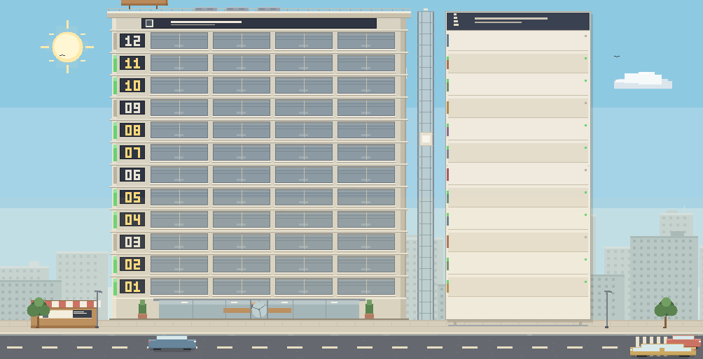
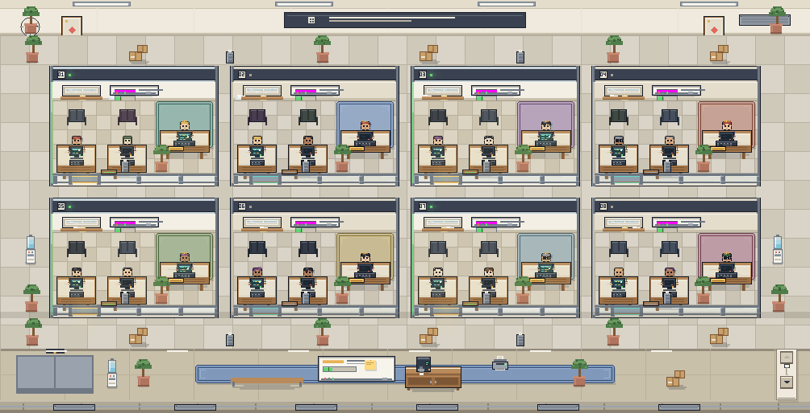
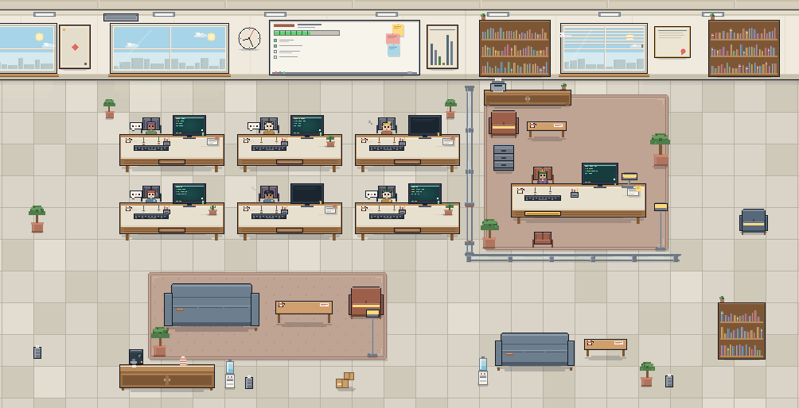
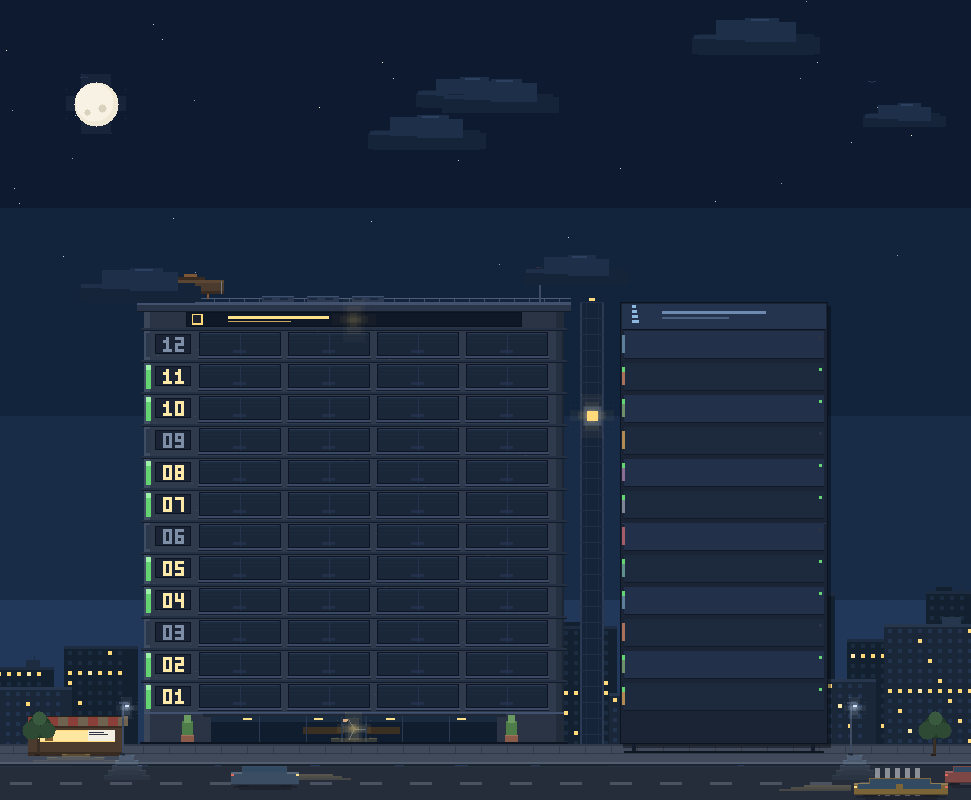

# Pixel Office · dsh-pixel-office

A fixed-pixel office tower for **DeepSeek Harness (DSH)**: all of your sessions become one building you can watch and click through.

> One tower = all workspaces · one floor = one workspace · one office on a floor = one session (one agent team)
> **A lit floor means work in progress.**

[](LICENSE)
[](https://github.com/Thunderunruly/agent-office)
[](https://github.com/deepseek-ai/deepseek-harness)

English | [简体中文](README.zh-CN.md)

## What it looks like

| All view — the tower | Workspace floor — the offices |
| --- | --- |
|  |  |

| Session room — the team | At night |
| --- | --- |
|  |  |

## Features

- **Sidebar entry next to your other panels** — a pixel tower icon opens the office page.
- **Three zoom levels**: the whole tower (all workspaces) → one workspace floor (all of its offices) → one session room (the team). Breadcrumbs and `Esc` walk back up.
- **Live data, no refresh**: subscribes to the host's `sessions.list` / `workspaces.list` snapshots, so running state, titles, team size, todo progress and recent work update in place.
- **Lights mean work**: floor status strips, office windows and desk lamps follow each session's `running` flag; day/night is automatic (07:00–19:00 is day) or switchable.
- **Agent Teams aware**: the `agentTeam` projection (lead + teammates) is used when present; when a projection is missing the roster is derived from the session graph (`parentId` children), so future orchestrators such as Super-agent workers show up as staff too. The main session gets the private office, teammates and subagents sit in the open office.
- **Click-through**: click a floor → workspace, click an office → room, click a character → open that session; `Esc` goes up one level.
- **Fixed-pixel world**: every object has a constant pixel size (floor 32, tower 420 wide, office 210×150, room core 760×488). Resizing the window reveals more or less of the office instead of stretching it; when a page no longer fits, the pixel pager on the elevator shaft flips pages.
- **Host-native chrome**: the page frames use the host's own `Button`, `SegmentedControl`, `Modal` and `Tooltip` where available (with a self-contained fallback), so light/dark themes and future DSH skins keep working.

## Install

Requires DSH **0.2.1-rc.3** or newer with the Web UI and plugin support.

1. **From the DSH Plugin Market** (after the catalog listing is merged): Plugins → Discover, search **Pixel Office**, install, then refresh the window once.
2. **From this repository** (source install):

   ```sh
   git clone https://github.com/Thunderunruly/agent-office.git
   ```

   then install the absolute folder through DSH's plugin manager:

   ```text
   install_bundle <path-to-agent-office>
   ```

3. **Local development folder**: the same `install_bundle <absolute path>` works on a checkout you edit; rebuild `client.js` with `node scripts/build.mjs` and refresh the window.

After installation, refresh the DSH window once so the client bundle enters the boot graph. Later client changes hot-reload in place.

## Usage

1. Click the tower icon in the left sidebar.
2. In the **All view**, each floor is a workspace; lit offices on that floor are working sessions. Click a floor to enter it.
3. In the **workspace view**, each glass office is a session: the lead's big desk plus the team's workstations. Click an office to enter the room.
4. In the **session room**, the lead sits in the private office on the right; teammates and subagents work in the open office. Click anyone to open that session.
5. Use the day/night switch at the top, or Settings → General → **Pixel office display**; the wheel / arrow keys / the pixel pager on the elevator shaft flip pages when the view has more floors or offices than fit.

## How it works

A bundle with a Host half and a Client half:

- `index.js` — Host entry; the current version only keeps the bundle shape stable for future Super-agent adapters.
- `client.js` — the browser module: subscribes to the session/workspace snapshots, folds them into an `OfficeModel` (workspace → floors → staff), then paints three fixed-pixel scenes on one canvas (responsive only in how much is visible). React owns the page chrome; the canvas owns the world.
- `cordis.patch.yml` — the bundle patch that inserts the plugin row.

No build system: `scripts/build.mjs` concatenates the owned sources in `src/` into the single-file Client module. `scripts/verify.mjs` runs the model and all scenes offline over several viewports, pages and day/night states.

## Privacy

- Only reads session metadata the host already exposes to Client plugins (titles, running state, update time, cwd, parent session, team projection, and the compact work/todo projection).
- Never reads session log files, never writes session logs, makes no network requests and carries no telemetry.
- One `localStorage` key: `dsh.pixel-office.display.v1` (day/night preference).

## Super-agent compatibility

The office models "who is working" as a generic session graph instead of hard-coding one multi-agent implementation:

- team leads (Agent Teams `lead`, and future `router`/`captain`/`boss` roles) sit in the boss office;
- team-member projections, or child sessions whose `parentId` points at the session (subagents, Super-agent workers) sit at desks in the open office;
- role normalization and staff derivation live in `src/model.js`, so a new host projection or role field only needs a small adapter there; the scenes and UI consume `OfficeModel` and never know where it came from.

## Known limitations

- The open office shows up to 6 seats; extra members appear as a “more members” chip.
- Read-only visualization: no approving permissions or sending messages from inside the room.
- Below ~700 logical pixels of width the fixed room core is cropped symmetrically (the boss office and all desks stay whole; outer wall decoration is trimmed).
- Visual verification happens against a running DSH page; the plugin ships no preview page of its own.

## Development

```powershell
cd agent-office
node scripts/build.mjs --check   # syntax / manifest / policy checks
node scripts/verify.mjs          # offline model + scene contract verification
node scripts/build.mjs           # emit client.js (refresh the DSH window afterwards)
```

Source layout and the frozen scene contracts are documented in [docs/SPEC.md](docs/SPEC.md). The release checklist (git tag, plugin-market PR, optional npm publish) is in [docs/RELEASING.md](docs/RELEASING.md).

## Disclaimer

An independent community plugin, not a DeepSeek official product. “DeepSeek”, “DeepSeek Harness” and “DSH” are used only to describe what this plugin works with.

## License

[MIT](LICENSE) © 2026 Thunderunruly
