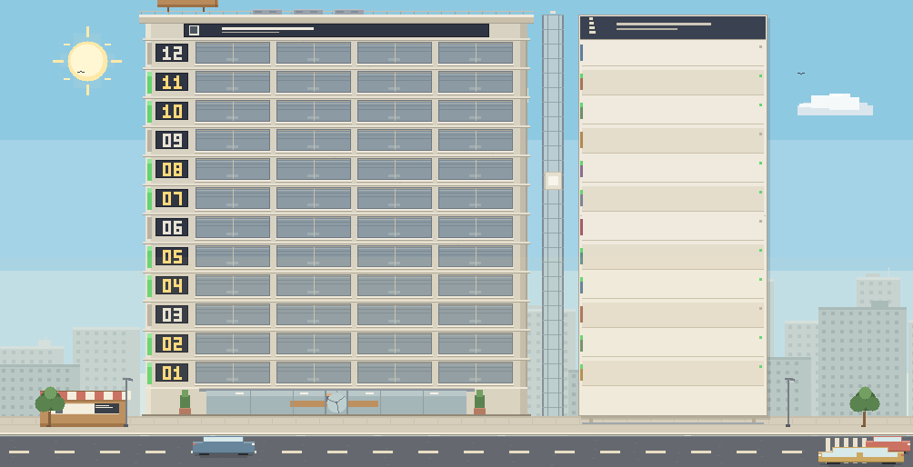
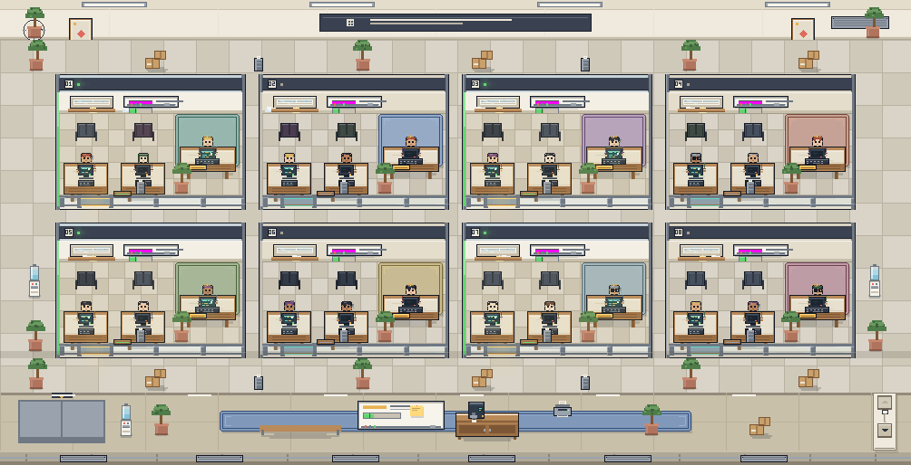
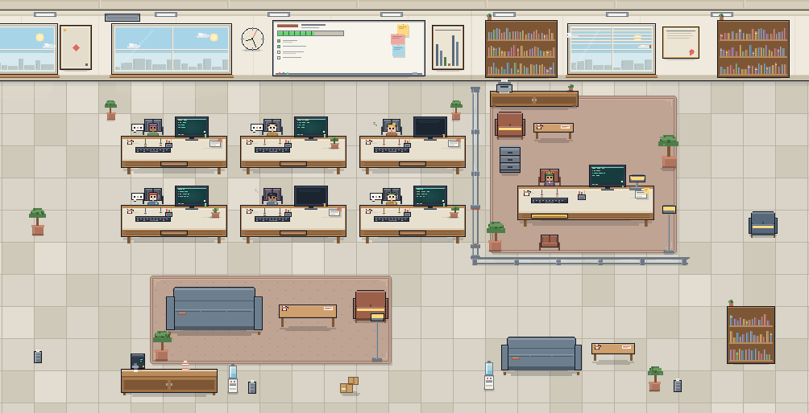
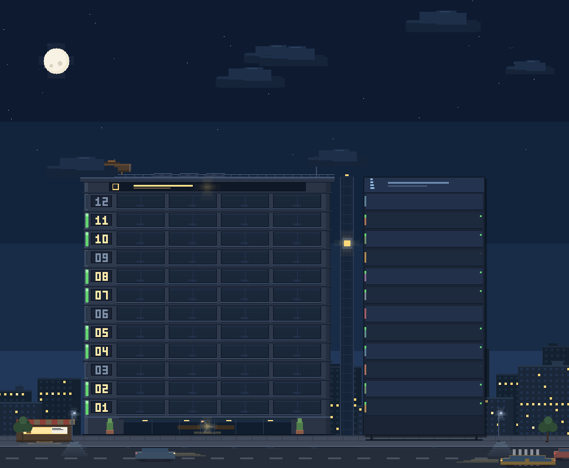

# 像素办公室 · dsh-pixel-office

给 **DeepSeek Harness (DSH)** 的 Web UI 加一个固定像素的办公室：所有会话变成一栋可以看、可以点的办公楼。

> 一栋楼 = 你的全部工作区 · 一层楼 = 一个工作区 · 一层里的每间办公室 = 一个会话（一个智能体团队）
> **哪层亮灯，就说明哪层在干活。**

[简体中文](README.zh-CN.md) | [English](README.md)

[](LICENSE)
[](https://github.com/Thunderunruly/agent-office)
[](https://github.com/deepseek-ai/deepseek-harness)

## 效果

| 全部视图 · 整栋楼 | 工作区视图 · 楼层平面 |
| --- | --- |
|  |  |

| 会话视图 · 团队房间 | 夜晚 |
| --- | --- |
|  |  |

## 功能

- **左侧栏入口**：与会话看板等项目并列的像素楼图标，点开即是办公室。
- **三种视图**：整栋楼（全部工作区）→ 工作区楼层平面（该层所有办公室）→ 会话房间（一个团队）。面包屑与 `Esc` 都能逐层返回。
- **活数据、不刷新**：订阅宿主的 `sessions.list` / `workspaces.list` 快照，运行状态、标题、团队人数、待办进度、最近工作实时更新。
- **亮灯即工作中**：楼层状态条、办公室窗户、桌面台灯都跟随 `running`；昼夜按本地时间 07:00–19:00 自动切换，也能手动锁定。
- **懂 Agent Teams**：优先使用 `agentTeam` 投影（lead + teammates）；投影缺席时从会话图（`parentId` 子会话）兜底推导员工。主会话坐老板办公室，团队成员与子代理坐开放办公区。Super-agent 等未来编排器的 Worker 会话同样按会话图显示，不需要改画布。
- **点击即导航**：点楼层进工作区，点办公室进房间，点房间里的角色直接打开那个会话；`Esc` 返回上一层。
- **固定像素世界**：每个物件尺寸固定（楼层 32px、楼宽 420、办公室 210×150、房间核心 760×488），调整窗口大小是"露出更多/更少"，不会把画面拉大压扁；一屏放不下时用电梯井上的像素翻页箭头按页翻。
- **宿主原生界面**：页面外壳优先使用宿主的 `Button` / `SegmentedControl` / `Modal` / `Tooltip`（拿不到时自动回退到内置实现），深浅色主题与未来的 DSH 皮肤都能跟随。

## 安装

需要 DSH **0.2.1-rc.3** 或更新版本（带 Web UI 与插件支持）。

1. **从 DSH 插件市场安装**（目录收录合并后）：插件 → 发现（Discover）→ 搜索 **像素办公室 / Pixel Office** → 安装，然后刷新一次窗口。
2. **从本仓库安装**（源码方式）：

   ```sh
   git clone https://github.com/Thunderunruly/agent-office.git
   ```

   然后在 DSH 插件管理器里安装这个绝对路径：

   ```text
   install_bundle <path-to-agent-office>
   ```

3. **本地开发目录**：同一套 `install_bundle <绝对路径>` 也适用于你正在改的 checkout；改完源码运行 `node scripts/build.mjs` 生成 `client.js`，刷新 DSH 窗口即可。

安装后需要刷新一次 DSH 窗口，让客户端 bundle 进入启动图；之后的客户端改动支持热加载。

## 使用

1. 点左侧栏的像素楼图标。
2. **全部视图**：每层是一个工作区，层里亮着的小办公室是工作中的会话。点楼层进入。
3. **工作区视图**：每间玻璃办公室是一个会话（老板大桌 + 团队工位）。点办公室进入房间。
4. **会话房间**：右侧老板办公室是主会话，左侧开放办公区是团队成员与子代理。点任意角色直接打开对应会话。
5. 顶部可切昼夜（或 设置 → 通用 → 像素办公室显示）；滚轮 / ↑↓ / 电梯井上的像素翻页箭头按页翻。

## 实现

一个 bundle 包含宿主端与客户端两半：

- `index.js` — 宿主入口，目前只保持 bundle 形态稳定，方便未来接 Super-agent 适配器。
- `client.js` — 浏览器模块：订阅会话/工作区快照，折叠成 `OfficeModel`（工作区 → 楼层 → 员工），再用一块 canvas 画三种固定像素场景（只响应"可见范围"，不缩放画面）。React 负责页面外壳，canvas 负责世界。
- `cordis.patch.yml` — 把插件行插入 profile 的 bundle patch。

没有构建系统：`scripts/build.mjs` 把 `src/` 里按所有权拆分的源码拼成单文件 Client 模块；`scripts/verify.mjs` 离线跑模型与全部场景的视口/分页/昼夜契约校验。

## 隐私

- 只读取宿主本来就会暴露给 Client 插件的会话元数据（标题、运行状态、更新时间、工作目录、父会话、团队投影、看板投影里的工作/待办摘要）。
- 不读会话日志文件、不写会话日志、不发网络请求、没有遥测。
- 只使用一个 `localStorage` 键：`dsh.pixel-office.display.v1`（昼夜偏好）。

## Super-agent 兼容

办公室把"谁在干活"抽象成通用会话图，而不是写死某一种多智能体实现：

- 团队领导（Agent Teams 的 `lead`，未来的 `router` / `captain` / `boss`）坐老板办公室；
- 团队投影成员，或 `parentId` 指向该会话的子会话（子代理、Super-agent 的 Worker）坐开放办公区工位；
- 角色归一与员工推导集中在 `src/model.js`，宿主以后给出新的团队投影/角色字段时只改这一处；画布与 UI 只消费 `OfficeModel`，不感知数据来源。

## 已知限制

- 开放办公区最多 6 个工位，多出的成员显示为「还有 N 位成员」提示。
- 房间是只读可视化：暂不支持在画布里批准权限或给会话发消息。
- 窗口宽度低于约 700 逻辑像素时，固定房间核心会被对称裁切（老板办公室和全部工位保持完整，只裁外围装饰）。
- 视觉验证在真实 DSH 页面进行；插件本身不附带预览页。

## 开发

```powershell
cd agent-office
node scripts/build.mjs --check   # 语法 / 清单 / 策略检查
node scripts/verify.mjs          # 离线模型 + 场景契约校验
node scripts/build.mjs           # 生成 client.js（之后刷新 DSH 窗口）
```

源码结构与冻结的场景契约见 [docs/SPEC.md](docs/SPEC.md)。

## 声明

独立社区插件，不是 DeepSeek 官方产品；文中使用 DeepSeek / DeepSeek Harness / DSH 仅用于说明兼容对象。

## 许可

[MIT](LICENSE) © 2026 Thunderunruly
